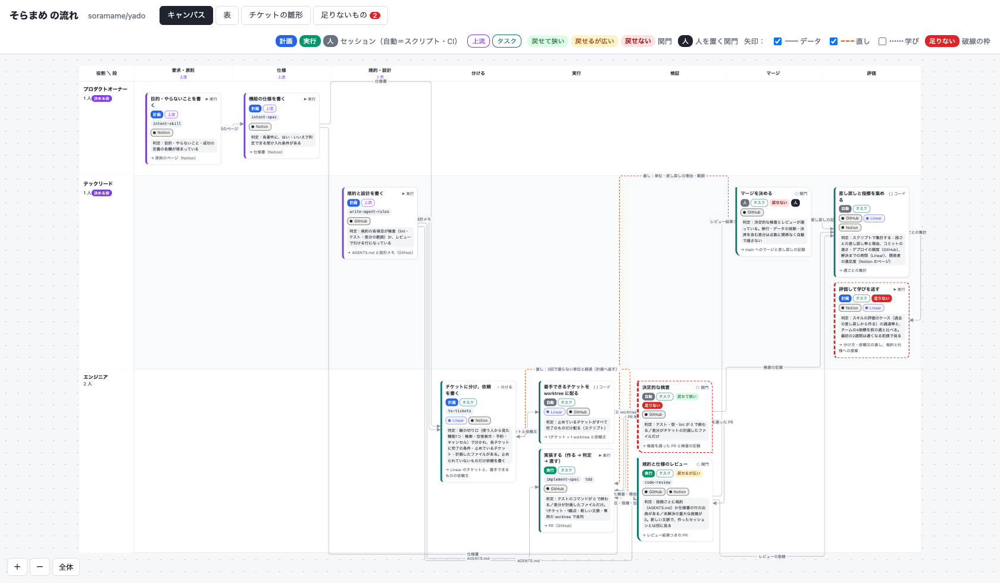

# skills

Agent skills for Claude Code. intent-skill creates, improves and restructures skills around what you want to solve: thin context, rules only where there is a real example, and evals instead of growing policies.

Claude Code などのエージェントで使うスキルを置くリポジトリです。

## インストール

### Claude Code の plugin（推奨）

```
/plugin marketplace add degwinthegreat/skills
/plugin install kstack@kstack
```

1つの plugin（`kstack`）に、intent-skill、cognitive-surrender、write-agent-rules、intent-spec、create-frontier-team が入っています。plugin のスキルには plugin の名前が付くので、`/kstack:intent-skill`、`/kstack:cognitive-surrender`、`/kstack:write-agent-rules`、`/kstack:intent-spec`、`/kstack:create-frontier-team` で呼びます。

### npx skills

```sh
npx skills add degwinthegreat/skills --skill intent-skill
npx skills add degwinthegreat/skills --skill cognitive-surrender
npx skills add degwinthegreat/skills --skill write-agent-rules
npx skills add degwinthegreat/skills --skill intent-spec
npx skills add degwinthegreat/skills --skill create-frontier-team
```

どれも1つだけで動きます。こちらは `/intent-skill`、`/cognitive-surrender`、`/write-agent-rules`、`/intent-spec`、`/create-frontier-team` で呼びます。

### 手で置く

`~/.claude/skills/` に、使うスキルのフォルダをリンクかコピーで置きます。

```sh
git clone https://github.com/degwinthegreat/skills.git
# リンク（pull すると更新される）
ln -s "$(pwd)/skills/intent-skill" ~/.claude/skills/intent-skill
ln -s "$(pwd)/skills/cognitive-surrender" ~/.claude/skills/cognitive-surrender
ln -s "$(pwd)/skills/write-agent-rules" ~/.claude/skills/write-agent-rules
ln -s "$(pwd)/skills/intent-spec" ~/.claude/skills/intent-spec
ln -s "$(pwd)/skills/create-frontier-team" ~/.claude/skills/create-frontier-team
# またはコピー
cp -R skills/intent-skill skills/cognitive-surrender skills/write-agent-rules skills/intent-spec skills/create-frontier-team ~/.claude/skills/
```

plugin と手で置いたものの両方があると、両方が読み込まれます。どちらか1つにしてください。

## intent-skill

スキルは、エージェントが良い選択をするための薄い材料にし、ルールは実例か人の決定があるものだけにする、という向きでスキルを扱います。1つのスキルに3つの節があります。

- **作る**：作るきっかけの実例を1つ書き、仕様（ユースケース、判定できる成功の定義、避けたい失敗の実例）を下書きして人が確かめます。参照先は [agent-taxonomy](https://agent-taxonomy.kawaida-dev.com) から3〜5件を選び、解決したいことに効くものだけを採ります。作るのは `SKILL.md` 1つで、仕様はその頭に書きます。
- **直す**：起きた失敗を1件の実例として受け、評価のケースにして直す前の版で落ちることを確かめ、最小の変更で直してケースが通るのを確かめます。足すのは実例か人の決定があるときだけで、削るのに回数は要りません。
- **組み立てを見直す**：複数のスキルが読む置き場や、スキルの分担の相談を受けます。置き場と読み手、スキルの関係を表にし、案を推奨付きで並べ、移行を PR に分けます。

- [SKILL.md](intent-skill/SKILL.md)
- 前の3つのスキルの方針と決定の記録：[docs/decisions/](docs/decisions/README.md)（凍結）

人が名前で呼ぶスキルです（`disable-model-invocation: true`）。手元にだけある道具（プロジェクトの知識をまとめたもの、作業の記録を測るツールなど）の使い方は、`intent-skill/local.md` に各自で書けます。スキルは、このファイルがあれば読み、無ければその部分を飛ばします。このリポジトリには入れていません（`.gitignore` で除いています）。plugin で入れたときは、スキルのフォルダが plugin の cache にあり、更新で入れ替わります。`local.md` を使うなら、「手で置く」のリンクで入れると、clone した側に置けます。

## cognitive-surrender

AI に作業を渡すとき、人がやり方だけを渡して判断を持ち続けているのか（任せる）、自分の答えを持たないまま出力を受け入れているのか（明け渡す）は、履歴に残りません。cognitive-surrender は、週に一度、人に一問だけ聞き、Claude Code のセッションの記録と git、プルリクエストの履歴から、確かめずに通したものを2〜3件選びます。それを、文脈を引き継がない別のエージェントに確かめさせ、任せただけか、明け渡していたかを見分けます。見つけたものは直さず、スキルが原因なら intent-skill の「直す」に、作業の進め方なら retro に渡します。用語は Addy Osmani の記事 [Cognitive Surrender](https://addyosmani.com/blog/cognitive-surrender/) の区別に揃えています。

- [SKILL.md](cognitive-surrender/SKILL.md)：手順
- このスキル自身のこれまでの方針と決定の記録：[docs/decisions/cognitive-surrender/](docs/decisions/cognitive-surrender/)（凍結）

v0 の試作で、まだ使っていません。人が名前で呼ぶスキルです（`disable-model-invocation: true`）。記録を集計する道具が手元にあれば、`cognitive-surrender/local.md` に使い方を書けます。扱いは intent-skill の `local.md` と同じです。

## write-agent-rules

エージェントが読むチームの規約（CLAUDE.md・AGENTS.md・steering・rules）を、書く・見直すときに使うスキルです。どのリポジトリでも使えます。規約は、エージェントが良い選択をするための薄い材料にします。チームが選んだことと理由、環境を見ても分からない落とし穴、作業の場面ごとに開く所を書きます。ルールは、実際に起きた誤りがあるものだけにします。見直しでは、実例のある4つの失敗に照らして直し方の表を作ります。4つは、規約が膨らんで読み切れない、規則を判断の時点で読まれない所に置く、記憶に頼る規則を文章だけで守らせる、実例の無いルールが積もる、です。毎回読まれる規約は 200 行以内にし、決まりは「〜する」の形で書き、手本はファイルを指します。チームの規約に決めがあれば、それに従います。仕様書は、[intent-spec](#intent-spec) で扱います。特定の製品の設定の書き方は扱いません。

- [SKILL.md](write-agent-rules/SKILL.md)：冒頭の仕様（ユースケース、成功の定義、避けたい失敗の実例）と手順。実例は、product-engineering の agent-instructions の出来事の記録（[receipts.md](https://github.com/phuryn/product-engineering/blob/50ee90fe47b538a0522b7fd35972f52b200f4515/agent-harness/skills/agent-instructions/receipts.md)、[prose-vs-code.md](https://github.com/phuryn/product-engineering/blob/50ee90fe47b538a0522b7fd35972f52b200f4515/agent-harness/skills/agent-instructions/references/prose-vs-code.md)）から
- このスキル自身のこれまでの方針と決定の記録：[docs/decisions/write-agent-rules/](docs/decisions/write-agent-rules/)（凍結）
- 評価のケース：[evals/](evals/README.md) の `rules-` で始まる2本

v0 の試作で、まだ使っていません。create-intent-skill（今の intent-skill）の手順で作りました。人が名前で呼ぶスキルです（`disable-model-invocation: true`）。ほかのスキルのファイルを読まないので、1つだけでも入れられます。

## intent-spec

設計・仕様書を書くスキルです。入口は3つあります。ゼロから作る、すでにあるプロダクトを参考に作る、すでにある仕様書を更新する、です。人に聞くのは、人しか知らないこと（目的、変えてはいけないもの、成功の定義）だけです。ほかはリポジトリから読み、下書き、自分での点検、文脈を持たない読み手のテストまで、止まらずに進めます。仕様書には、判定できる完了の条件、範囲の外、未決の問い（推測で埋めない）、変えてはいけないもの（既存があるとき）を必ず入れます。リポジトリに用語集や feature map があれば、その語と機能の ID で書きます。無ければ作らずに、使った語の一覧を返します。更新は、足す・変える・消す・名前を変えるの差分で書き、消すものには理由を付けます。

anthropic の product-management の write-spec との違い：write-spec は、PRD の型に沿って、問いを会話で1つずつ重ねて埋めます。intent-spec は、聞くのを人しか知らない3つに限り、既存の仕様書の差分の更新と、変えてはいけないものまでを1回で書き上げます。

- [SKILL.md](intent-spec/SKILL.md)：冒頭の仕様（ユースケース、成功の定義、避けたい失敗）と進め方
- 評価のケース：[evals/](evals/README.md) の `spec-` で始まる3本

v0 の試作で、まだ使っていません。intent-skill の「作る」の手順で作りました。人が名前で呼ぶスキルです（`disable-model-invocation: true`）。ほかのスキルのファイルを読まないので、1つだけでも入れられます。

## create-frontier-team

チームを frontier team（AI エージェントに合わせて開発の進め方を作り直したチーム）に仕上げるための、流れを設計するスキルです。要求・原則 → 仕様 → チケット → 計画 → 実行 → PR → 検証 → 評価 の段ごとに、誰が・どのスキルを・どの種類のセッション（計画か実行か）で・どのツールの上で使うかを決めます。上流（方針・仕様・規約）のスキルは決める役の人だけが持ち、タスクの実行は、依頼を書く計画のセッションと、1チケットに1つの実行のセッションに分けます。ノードには種類（分ける・実行・コード・関門）を付け、関門は間違えたときの戻しにくさで分け、戻り道を直しの辺と学びの辺の2本にし、人は1か所に置きます。人に聞くのは、役割と人数、使っているツール、対象のリポジトリだけです。

出力は、ノードと矢印のキャンバスです。スキルは設計を JSON にまとめ、同梱の `canvas.html`（外のファイルやネットワークを使わない1ファイル。パン・ズーム、ノードをクリックで詳細）に埋め込んで書き出します。描画は HTML がするので、呼ぶたびに形が変わりません。表、チケットの雛形、足りないもの（スキルや検証・評価の無い段、戻り道や関門の抜け）も、同じ JSON から HTML のタブに出ます。ツールはロゴを使わず、名前と色のバッジで表します。

架空の4人のチームで1回出した例です。



- [SKILL.md](create-frontier-team/SKILL.md)：冒頭の仕様（作るきっかけ、ユースケース、成功の定義、避けたい失敗）、判断の材料、進め方
- [canvas.html](create-frontier-team/canvas.html)：決まった描画
- 評価のケース：[evals/](evals/README.md) の `frontier-` で始まる2本

v0 の試作で、まだ使っていません。intent-skill の「作る」の手順で作りました。人が名前で呼ぶスキルです（`disable-model-invocation: true`）。ほかのスキルのファイルを読まないので、1つだけでも入れられます。

## 方針と決定の記録

これまで各スキルのフォルダにあった `policy.md`・`decisions.md` と共有の方針は、[docs/decisions/](docs/decisions/README.md) に移して凍結しました。スキルの実行では読みません。これからの変更の理由は、PR の本文とコミットに書きます。

## 評価

スキルの評価のケースを [evals/](evals/README.md) に置いています（`claude plugin eval` の形）。plugin で入れたときも、スキルの実行では読みません。

## agent-taxonomy との関係

intent-skill は、スキルを作るときの参照先を [agent-taxonomy](https://agent-taxonomy.kawaida-dev.com) から探します。サイトの [llms.txt](https://agent-taxonomy.kawaida-dev.com/llms.txt) から参照先のスキルを選び、ルールの置き場所は [/principles の「Writing a skill」](https://agent-taxonomy.kawaida-dev.com/principles/#authoring)の手順で決めます。intent-skill の正本は、このリポジトリです。

サイトが使えないときは、参照先のスキルを3〜5件、使う人が自分で挙げれば足ります。残りの手順はそのまま動きます。

## ライセンス

[MIT](LICENSE)
